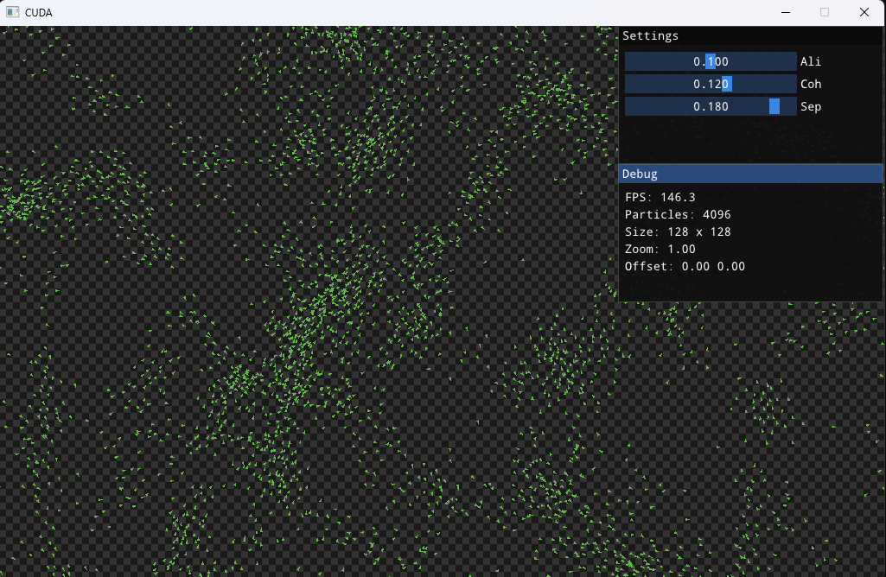

# CUDA Particle System



A GPU-accelerated particle system implemented in C++ and CUDA, featuring a real-time Boids simulation.

The system uses grid-based spatial sorting to efficiently organize particles and accelerate neighbor searches, enabling large-scale particle interactions with high performance.

## Controls

- **Middle Mouse Button + Drag** – Pan the view.
- **Mouse Wheel** – Zoom in and out.

## Build & Run

Requires CMake, Ninja, and a CUDA-compatible environment.

```bash
cmake -S . -B build -G Ninja
cmake --build build
.\build\main.exe
```
